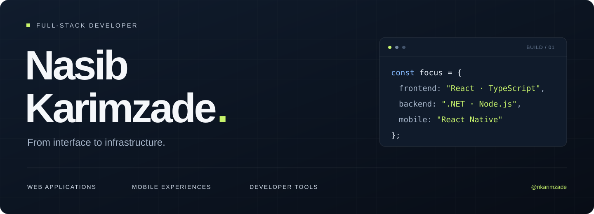

  

  <a href="https://nasibkarimzade.vercel.app"><b>Portfolio ↗</b></a>&nbsp;&nbsp; / &nbsp;&nbsp;<a href="#selected-work"><b>Selected work ↓</b></a>&nbsp;&nbsp; / &nbsp;&nbsp;<a href="https://github.com/nkarimzade?tab=repositories"><b>Repositories ↗</b></a>

I build across the stack: interactive interfaces, backend services and mobile applications. My projects range from browser-based 3D editors to real-time engineering dashboards and reusable React libraries.

## Selected work

<table>
<tr>
<td width="50%" valign="top">
<h3>01 / PackCraft</h3>

A packaging design workspace in the browser. Edit box dimensions, preview dielines and place artwork directly on a 3D model.

REACT · THREE.JS · 3D EDITING

<b>Private source</b> · Product showcase

</td>
<td width="50%" valign="top">
<h3>02 / Pipeline Intelligence</h3>

A CI/CD dashboard connecting Jenkins builds, live logs and AI-assisted failure analysis in one real-time interface.

REACT · TYPESCRIPT · .NET · SIGNALR

<b>Private source</b> · Engineering tooling

</td>
</tr>
<tr>
<td width="50%" valign="top">
<h3>03 / ProxiWake</h3>

A location-based arrival alarm with background tracking, saved routes and notifications, built for mobile.

REACT NATIVE · EXPO · LOCATION SERVICES

<b>Private source</b> · Mobile application

</td>
<td width="50%" valign="top">
<h3>04 / React Permission Gate</h3>

A TypeScript-first React library for declarative role- and permission-based rendering.

REACT · TYPESCRIPT · LIBRARY DEVELOPMENT

<a href="https://github.com/nkarimzade/react-permission-gate"><b>Explore the repository ↗</b></a>

</td>
</tr>
<tr>
<td width="50%" valign="top">
<h3>05 / Interactive 3D Portfolio</h3>

A developer portfolio exploring interactive 3D scenes, motion and browser-based visual experiences.

REACT · TYPESCRIPT · THREE.JS · GSAP

<a href="https://github.com/nkarimzade/interactive-3d-portfolio"><b>Explore the repository ↗</b></a>

</td>
<td width="50%" valign="top">
<h3>06 / Bavio Marketplace</h3>

A multi-store commerce application with seller dashboards, product listings, shopping carts and an Express backend.

REACT · NODE.JS · EXPRESS · E-COMMERCE

<a href="https://github.com/nkarimzade/bavio-marketplace"><b>Explore the repository ↗</b></a>

</td>
</tr>
</table>

## Tools I work with

| Interface | Services | Mobile & real-time |
| :--- | :--- | :--- |
| React, TypeScript, JavaScript | C#, ASP.NET Core, Node.js | React Native, Expo |
| Three.js, GSAP, Vite | Express, REST APIs | SignalR, location services |

Private projects are presented as summaries. Their source code remains private.
